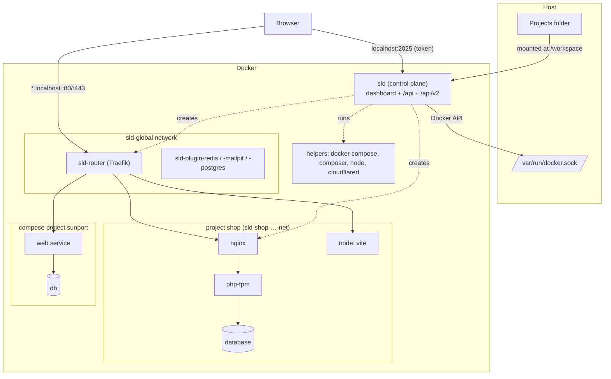

# SLD Architecture

*Current as of Phase 15 (2026-11). Decisions: [`docs/adr`](../adr). How we got here: [`SLD_V2_PHASE15_CUTOVER.md`](SLD_V2_PHASE15_CUTOVER.md).*

## 1. Product

**Supreme Local Dev (SLD) is a local development control plane that runs as one Docker container.** It finds the projects in a folder you mount, runs each one in containers with a `<name>.localhost` domain, and lets you manage projects, databases, logs and HTTPS from a dashboard.

- **Stacks:** PHP (Laravel, Symfony, WordPress), Node, Python, Ruby, Go, static sites, a Dockerfile, any image, an existing Docker Compose project, or a process already running on the host.
- **Platforms:** anything that runs Docker: Linux, macOS and Windows (Docker Desktop).
- **Two front ends, one engine:** the dashboard (`sld serve`, the image's default command) and the CLI (`sld start`, `sld scan`, ...) for people who don't run the image.
- **Out of scope:** installing software on the host, editing the hosts file or system DNS, production deployment.

## 2. Principles

1. **The host is not changed.** Everything runs in containers. SLD installs nothing, edits no system files, and never calls a package manager ([ADR 0001](../adr/0001-docker-engine-runtime.md), [ADR 0008](../adr/0008-containerised-control-plane.md)).
2. **Docker is the state.** Running state is read from Docker through standard labels; the project's `.sld/config.yaml` is the desired state ([ADR 0006](../adr/0006-reconciliation-model.md)).
3. **Any runtime through drivers.** A project is a list of apps; each runtime has a driver that plans its containers ([ADR 0007](../adr/0007-multi-runtime-drivers.md)).
4. **Projects keep their own setup.** Compose projects run their own compose files; SLD only adds routing and removes clashing host ports.
5. **Locked down by default.** The API needs a token, listens on loopback, and checks Host/Origin/CSRF ([ADR 0010](../adr/0010-control-plane-authentication.md)).
6. **One identity everywhere.** A project's ID comes from its host path, so the image and the CLI manage the same containers ([ADR 0003](../adr/0003-project-identity.md), [ADR 0009](../adr/0009-path-mapping-and-workspace-mounts.md)).

## 3. Components

| Component | Code | Role |
|---|---|---|
| Control plane | `cmd/sld/serve.go`, `internal/server` | HTTP server: dashboard, `/api/v2` (projects, jobs, logs, settings, auth), Docker-backed `/api` routes for the original pages (sites, services, plugins, share, doctor, metrics, new project) |
| Database manager | `pkg/daemon/api`, `pkg/services` | `/api/db/*`: browse, query, import, snapshot, clone databases on discovered MySQL/MariaDB/PostgreSQL containers |
| Runner | `internal/v2` | Project operations shared by the API and the CLI: init, scan, start, stop, destroy, logs, exec |
| Orchestrator | `internal/orchestrate` | Plans → containers: networks, volumes, image builds, reconcile, health waits, compose stacks, waiting for routes |
| Drivers | `internal/runtime` | One per runtime: turn an app into containers / builds / routes |
| Detection | `internal/detect` | Finds projects in a folder and writes their config |
| Host environment | `internal/hostenv` | In-container vs host, path translation, ports, project identity |
| TLS | `internal/tls` | SLD's own CA, one certificate per project, Traefik TLS config |
| Router | `docker/router` (Traefik v3.6) | Routes `*.localhost` to containers by Docker labels; file routes for the proxy runtime |
| Images | `docker/php`, `docker/nginx` | `sld-php:8.1–8.4` (FPM, extensions, Composer), `sld-nginx` |

## 4. Request flow

1. The browser resolves `shop.localhost` to 127.0.0.1 by itself (no DNS setup).
2. The request reaches `sld-router` on the host's HTTP/HTTPS ports (80/443, or `SLD_HTTP_PORT` / `SLD_HTTPS_PORT`).
3. Traefik picks the route from the container labels and, for HTTPS, the project's certificate signed by SLD's CA.
4. The request goes to the app container on the shared `sld-global` network:
   - nginx (which hands PHP to PHP-FPM over FastCGI, [ADR 0004](../adr/0004-fastcgi-nginx-php-separation.md));
   - a dev server (Vite, Next.js, Django, ...);
   - a static nginx;
   - the routed service of a compose stack.
5. App containers reach their database, Redis and Mailpit on the private project network.

`start` returns only once the router serves every domain of the project, so "started" also means "reachable".

## 5. Projects

- **Discovery:** a project is a folder with `.git`, `.sld/config.yaml` or its own compose file, found up to three levels deep in each workspace. Group folders such as `laravel-builds/` are searched inside. `.sldignore` hides a folder.
- **Config:** `.sld/config.yaml`, `version: 2`, an ordered list of apps plus services. Version 1 files are upgraded in memory.
- **Domains:**
  - first app: `<name>.localhost`;
  - other apps: `<app>.<name>.localhost`;
  - `domain.aliases` add more.

  The TLD defaults to `localhost` (`SLD_TLD` changes it); for TLDs that don't resolve by themselves, SLD prints the hosts lines to add.
- **Resources:**
  - project network: `sld-<id>-net`, created only when SLD runs containers of its own for the project;
  - containers: `sld-<id>-<app|service>`;
  - volumes: `sld-<id>-…`;
  - all labelled `com.supreme.sld.*`.
- **Users and files:** app processes run as the owner of the project folder; dependencies live in per-app volumes keyed by the lockfile hash.
- **Databases:**
  - **project databases:** `services.database.type` gives the project its own MySQL/MariaDB/PostgreSQL container and a named volume. Generated credentials are kept in the project's `.sld/secrets.json` (mode 0600; keep it out of git), and data survives `stop` and `destroy` without `--volumes`;
  - **shared servers:** the bundled compose stack provides MariaDB, Redis and Mailpit; the Plugins page adds PostgreSQL. The database manager works with any of them;
  - `services.database.shared`, which will put a project's database on a shared server, is reserved but not implemented yet.

## 6. Control plane

- **Data directory** (`/home/sld/.sld` in the image, a named volume):
  - `auth.json` (token hash);
  - `settings.json` (automation, autostart, site tags);
  - `router.json` (ports);
  - `ca/`, `certs/` and `traefik/` (TLS);
  - generated compose overrides and nginx configs.
- **Jobs:** set up, start, stop, restart, destroy, create and clone run as background jobs whose output streams to the dashboard (SSE). Only one job runs per project at a time.
- **Automation** (on start):
  - optionally write configs for new projects;
  - restart what was running (default on);
  - start autostart projects, or everything.

  Starts run one at a time.
- **Original pages:** they keep their API shapes, answered from Docker:
  - services: SLD's own containers;
  - plugins: `sld-plugin-*` containers;
  - share: a cloudflared container;
  - new project: Composer/Node helper containers;
  - Ghost Mode: Go copy plus a marker file.

## 7. Distribution

- **Image:** `ghcr.io/supreme-majesty/sld`, multi-arch, built by `.github/workflows/docker-images.yml` together with `sld-router`, `sld-nginx` and `sld-php:8.1–8.4`.
- **Compose:** `compose.yaml` in the repository runs SLD plus MariaDB, Redis, Mailpit and phpMyAdmin (PostgreSQL with `--profile postgres`).
- **CLI binaries:** Linux, macOS and Windows binaries are attached to each GitHub release.
- **Tests:** `go test ./...` for the engine and server. `scripts/e2e.sh` runs the image against sample projects of every runtime in an isolated router and network.

## 8. Security

See [ADR 0010](../adr/0010-control-plane-authentication.md) and [`SLD_V2_SECURITY.md`](SLD_V2_SECURITY.md). In short:
- the Docker socket is root-equivalent, so SLD binds to loopback, requires the token for every route, and refuses foreign Host headers and cross-site writes;
- project containers never get the socket; only SLD's own helpers (compose) do;
- static sites refuse hidden files (`.git`, `.env`, `.sld`).
